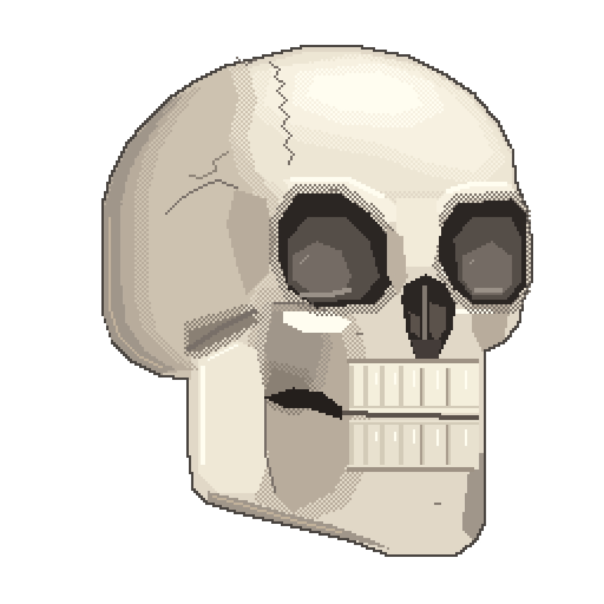

# Stiwi: a hand-authored semantic portrait


Authored by **GPT-6.1-Sol running in Codex (model as declared by the
harness)**. This records the selected model; it is not an independent
attestation of the backend. Pixelsrc rendered the artwork.

The model placed every palette colour and geometric region by hand while
looking at a photo reference. There was no image import, quantizer or tracing.
The reference photo is intentionally not included or linked here.

The portrait went through **six revisions with human feedback**: softening the
side hair, curving the moustache, exposing a small philtrum, and closing a gap
in the right forelock. Named palette tokens, semantic roles and relationships,
and layered `rect`, `union`, `points`, `line` and `stroke` regions make those
changes editable rather than requiring a new pixel grid.

| Variant | Editable source | Native render | Nearest-neighbour preview |
| --- | --- | --- | --- |
| Detailed, 48 × 48 | [source](stiwi-hand-48.pxl) | [PNG](stiwi-hand-48.png) | [528 × 528](stiwi-hand-48-preview.png) |
| Compact, 32 × 32 | [source](stiwi-hand-32.pxl) | [PNG](stiwi-hand-32.png) | [512 × 512](stiwi-hand-32-preview.png) |

The 48-pixel portrait is independently authored, not an enlargement of the
32-pixel study.

## The skull self-portraits, 128 and 256



Stiwi's skull avatar, the 3/4 view from
[`examples/skull/reference-skull.jpg`](../skull/reference-skull.jpg), at two
large sizes. Authored by **Claude Opus 5.5 running in Claude Code (model as
declared by the harness)**. Every region is placed by hand as a path, line or
point list; there was no image import, quantizer or tracing.

| Variant | Editable source | Native render | Nearest-neighbour preview |
| --- | --- | --- | --- |
| Pixel art, 128 × 128 | [source](stiwi-128.pxl) | [PNG](stiwi-128.png) | [1024 × 1024](stiwi-128-preview.png) |
| Painterly, 256 × 256 | [source](stiwi-256.pxl) | [PNG](stiwi-256.png) | [1024 × 1024](stiwi-256-preview.png) |

**128** keeps to flat pixel-art planes: a six-step bone ramp, angular
scowling orbits with lit lower walls, the coronal and squamous sutures, the
zygomatic arch and a two-row bite.

**256** starts from the 128 portrait's big planes at double size and paints
on top of them: a nine-step ramp, warm reflected light under the cranium,
ambient occlusion around the orbits, nasal turbinates, foramina, a hairline
crack and per-tooth shading with glints. The soft transitions are 50%
checker dithers. One hidden `grain` region holds the checkerboard (every pixel
with an even x + y, written as diagonal one-pixel lines), and each transition
is a hand-drawn band with `except: ["grain"]`.

Two compiler findings came out of the 256:

* `except` read its target in hash-map order, so `except: ["grain"]` failed
  with "Unknown token" in most runs. Regions now rasterize in dependency order
  (`structured::rasterize_regions`), shared by render, mask, diff and validate.
* The sprite-level `dither` transform rejects a regions sprite ("color-based
  transforms require palette context"), which is why the dithering is built
  from regions instead.

## A renderer bug found during the revisions

A three-pixel forelock exposed that semantic `line` regions ignored their
`thickness`, including inside a `union`. [PR #25](https://github.com/scbrown/pixelsrc/pull/25)
fixed the renderer and added PNG/mask regression coverage. These examples
require a build containing that fix.

## Validate and render

From this directory, using `pxl` built from the repository:

```sh
pxl validate --strict stiwi-hand-48.pxl
pxl validate --strict stiwi-hand-32.pxl
pxl render stiwi-hand-48.pxl --strict --scale 1 -o stiwi-hand-48.png
pxl render stiwi-hand-48.pxl --strict --scale 11 -o stiwi-hand-48-preview.png
pxl render stiwi-hand-32.pxl --strict --scale 1 -o stiwi-hand-32.png
pxl render stiwi-hand-32.pxl --strict --scale 16 -o stiwi-hand-32-preview.png
pxl validate --strict stiwi-128.pxl stiwi-256.pxl
pxl render stiwi-128.pxl --strict --scale 1 -o stiwi-128.png
pxl render stiwi-128.pxl --strict --scale 8 -o stiwi-128-preview.png
pxl render stiwi-256.pxl --strict --scale 1 -o stiwi-256.png
pxl render stiwi-256.pxl --strict --scale 4 -o stiwi-256-preview.png
```

`cargo test --test stiwi_example` validates all four sources strictly and
compares all eight newly rendered PNGs with the saved artwork.
