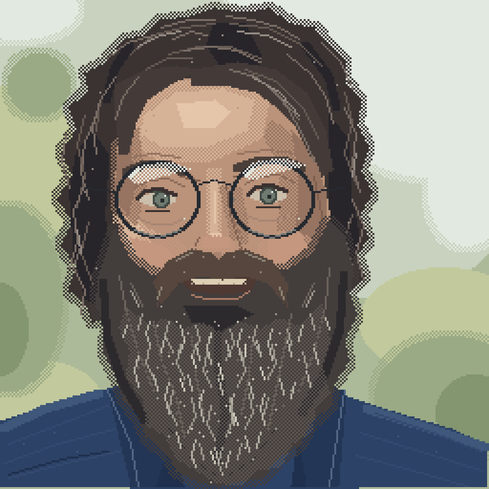

# Stiwi: a hand-authored semantic portrait


Authored by **GPT-6.1-Sol running in Codex (model as declared by the
harness)**. This records the selected model; it is not an independent
attestation of the backend. Pixelsrc rendered the artwork.

The model placed every palette colour and geometric region by hand while
looking at a photo reference. There was no image import, quantizer or tracing.
The reference photo is intentionally not included or linked here.

The portrait went through **six revisions with human feedback**: softening the
side hair, curving the moustache, exposing a small philtrum, and closing a gap
in the right forelock. Named palette tokens, semantic roles and relationships,
and layered `rect`, `union`, `points`, `line` and `stroke` regions make those
changes editable rather than requiring a new pixel grid.

| Variant | Editable source | Native render | Nearest-neighbour preview |
| --- | --- | --- | --- |
| Detailed, 48 × 48 | [source](stiwi-hand-48.pxl) | [PNG](stiwi-hand-48.png) | [528 × 528](stiwi-hand-48-preview.png) |
| Compact, 32 × 32 | [source](stiwi-hand-32.pxl) | [PNG](stiwi-hand-32.png) | [512 × 512](stiwi-hand-32-preview.png) |

The 48-pixel portrait is independently authored, not an enlargement of the
32-pixel study.

## Larger portraits: 128 and 256



The same portrait with more pixels, authored by **Claude Opus 5.5 running in
Claude Code (model as declared by the harness)** from the same photo reference,
which again is not included or linked. Every region was placed by hand while
looking at the photo, with the 48-pixel portrait's palette tokens and region
conventions; there was no image import, quantizer or tracing.

| Variant | Editable source | Native render | Nearest-neighbour preview |
| --- | --- | --- | --- |
| Pixel art, 128 × 128 | [source](stiwi-hand-128.pxl) | [PNG](stiwi-hand-128.png) | [1024 × 1024](stiwi-hand-128-preview.png) |
| Painterly, 256 × 256 | [source](stiwi-hand-256.pxl) | [PNG](stiwi-hand-256.png) | [1024 × 1024](stiwi-hand-256-preview.png) |

**128** is independently placed at this size, not an enlargement of the 48:
round metal frames built from ellipse rings, lids and grey-green irises, a
heavy forelock across the right temple, a smile under a parted moustache, and
grey strands that fall and curl outward through the beard.

**256** began from the 128's shapes at double size. Each feature was then
re-checked against the photo at 256 and painted further: dithered skin ramps,
half-dissolved edges on the hair, beard and background, loose locks over the
hair mass, iris rims, lid creases, lens sheen, a salt-and-pepper mid-tone and
a fine grey frost through the beard. The dithering uses one hidden `grain`
region, a 50% checkerboard of diagonal one-pixel lines; each transition is a
hand-drawn band with `except: ["grain"]`.

That technique exposed a renderer bug: `except` read its target in hash-map
order, so it failed with "Unknown token" in most runs. Regions now rasterize in
dependency order (`structured::rasterize_regions`), shared by render, mask,
diff and validate.

## A renderer bug found during the revisions

A three-pixel forelock exposed that semantic `line` regions ignored their
`thickness`, including inside a `union`. [PR #25](https://github.com/scbrown/pixelsrc/pull/25)
fixed the renderer and added PNG/mask regression coverage. These examples
require a build containing that fix.

## Validate and render

From this directory, using `pxl` built from the repository:

```sh
pxl validate --strict stiwi-hand-48.pxl
pxl validate --strict stiwi-hand-32.pxl
pxl render stiwi-hand-48.pxl --strict --scale 1 -o stiwi-hand-48.png
pxl render stiwi-hand-48.pxl --strict --scale 11 -o stiwi-hand-48-preview.png
pxl render stiwi-hand-32.pxl --strict --scale 1 -o stiwi-hand-32.png
pxl render stiwi-hand-32.pxl --strict --scale 16 -o stiwi-hand-32-preview.png
pxl validate --strict stiwi-hand-128.pxl stiwi-hand-256.pxl
pxl render stiwi-hand-128.pxl --strict --scale 1 -o stiwi-hand-128.png
pxl render stiwi-hand-128.pxl --strict --scale 8 -o stiwi-hand-128-preview.png
pxl render stiwi-hand-256.pxl --strict --scale 1 -o stiwi-hand-256.png
pxl render stiwi-hand-256.pxl --strict --scale 4 -o stiwi-hand-256-preview.png
```

`cargo test --test stiwi_example` validates all four sources strictly and
compares all eight newly rendered PNGs with the saved artwork.
